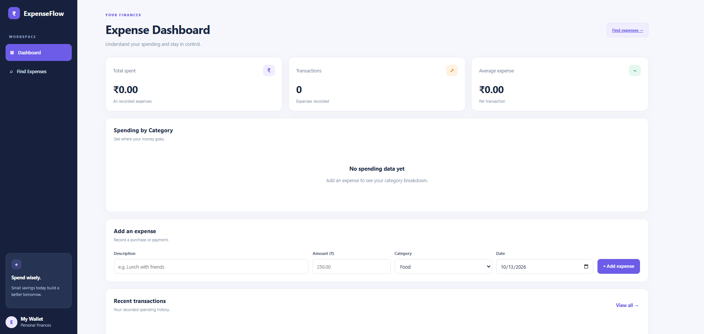
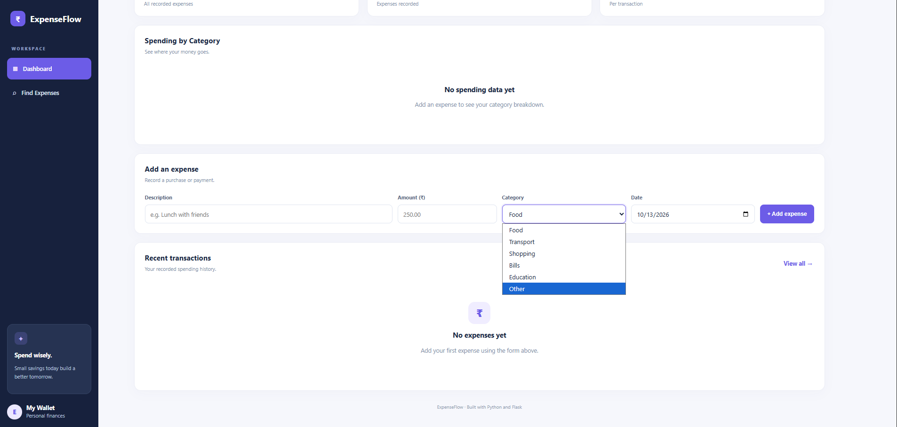
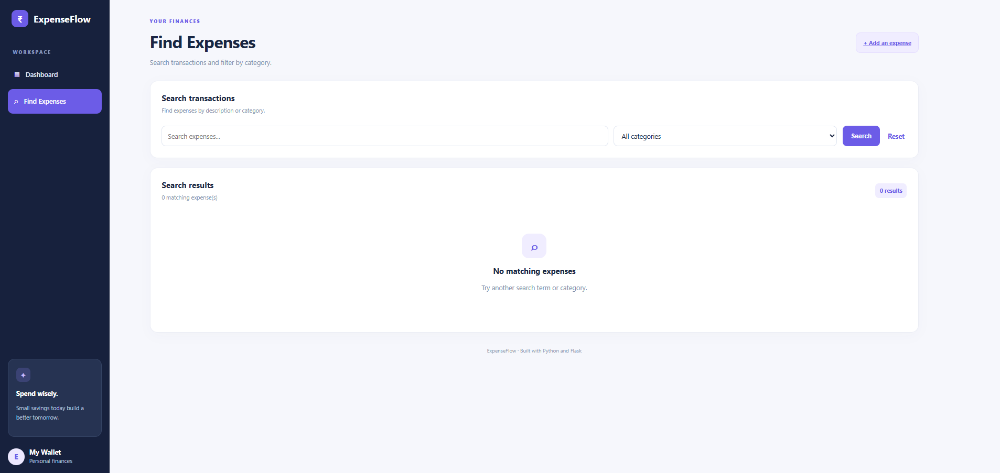

# ExpenseFlow — Expense Tracker Dashboard

ExpenseFlow is a web-based expense tracking application built with Python and Flask. It helps users record expenses, organize spending by category, and review their transaction history through a clean dashboard.

## Features

- Add expenses with descriptions, amounts, categories, and dates
- View total spending, transaction count, and average expense
- Visualize spending by category
- Search expenses by description
- Filter transactions by category
- Delete expenses
- Display success and error messages
- Store expense records using JSON

## Technologies Used

- Python
- Flask
- HTML
- CSS
- JavaScript (if used)
- JSON

## Project Structure

```text
ExpenseFlow/
├── app.py
├── expenses.json
├── requirements.txt
├── README.md
├── .gitignore
├── templates/
│   ├── index.html
│   └── find.html
└── static/
    ├── style.css
    └── script.js
```

## Installation and Setup

### 1. Clone the repository

```bash
git clone https://github.com/YOUR-USERNAME/expenseflow-dashboard.git
cd expenseflow-dashboard
```

Replace `YOUR-USERNAME` with your GitHub username.

### 2. Create a virtual environment

```bash
python -m venv .venv
```

Activate it on Windows:

```bash
.venv\Scripts\activate
```

### 3. Install dependencies

```bash
pip install -r requirements.txt
```

### 4. Run the application

```bash
python app.py
```

Open http://127.0.0.1:5000 in your browser.

## Learning Outcomes

This project helped me practise Python functions, Flask routes, HTML templates, form handling, input validation, JSON file storage, and dashboard styling.

## Future Improvements

- Add monthly spending reports
- Add expense editing
- Add budget limits and alerts
- Improve data storage with a database
- Deploy the application online

## Author

Bharath

Built as a Python learning project.
## Screenshots





